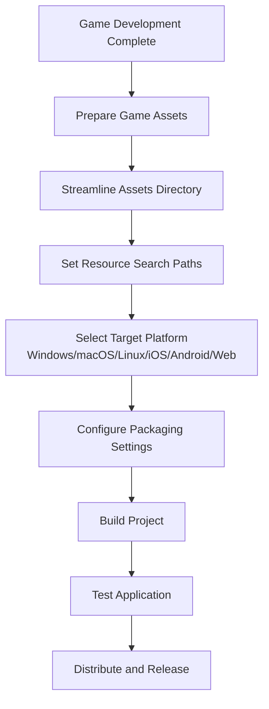

import DocScreenshot from '@site/src/components/DocScreenshot';
import exportImage from '@site/static/img/operations/export-dialog-en.webp';
import exportFilesImage from '@site/static/img/operations/export-files.webp';
import exportBrowserImage from '@site/static/img/operations/export-browser.webp';

import Tabs from '@theme/Tabs';
import TabItem from '@theme/TabItem';

# How to Package Games as Standalone Applications

Use the Web IDE on a Dora host running Windows, macOS, Linux, Android, or iOS to export Web games, Windows x64 ZIPs, and Android APKs. On Windows, macOS, and Linux you can also use [Dora CLI export](./115.command-line-interface.mdx#export-a-game). Dora packages games in the engine. Exporting an existing project requires no additional installation of Node.js, a JDK, an Android SDK, or a WebView.

Dora downloads any missing runtime templates on demand and caches them for offline use with the matching engine version and revision. The platform build guides below cover building standalone applications from engine source.

## Export a playable Web game from the IDE

For a finished Dora project, the quickest path is Web IDE export. Keep the normal project layout with `init` at its root; no engine source build is needed for this workflow.

1. Save the project and run it once to check that scripts and resources load.
2. Right-click its **project folder** and choose **Export**, or open a project file and use the toolbar Export button.
3. Choose **Export HTML** for a game that can be opened locally, or **Export server HTML** for a game to serve over HTTP. Wait for packaging and choose where to save the download.

<DocScreenshot src={exportImage} width={960} height={1040} alt="Project export dialog showing ZIP and both Web export formats" maxWidth={600} />

### Extract and open the result

**Export HTML downloads a ZIP archive**, such as `Hello-web-html.zip`. Extract the entire archive, then open the root `index.html` in a browser. Keep its accompanying files and `html-assets` directory together. Copying only `index.html` leaves out the engine and game resources.

<DocScreenshot src={exportFilesImage} width={1030} height={440} alt="Extracted Web package files, with index.html selected and html-assets beside it" maxWidth={600} />

The example below was exported from the Hello project and opened directly from the extracted directory in Edge.

<DocScreenshot src={exportBrowserImage} width={3008} height={1724} alt="Exported Hello project running in a browser from the extracted package" />

For **Export server HTML**, extract the ZIP and deploy the entire output directory to a static host, then open its `index.html` over HTTPS or localhost. This format needs a server; read the package's `README-Web.txt` for hosting requirements. Godot Web packages also require COOP/COEP response headers.

### Verify before sharing

- Compare the exported result with the project running in Dora: images, fonts, sound, and input should work.
- For server output, test the deployed URL and resource requests rather than opening the file directly.
- Use **Export ZIP** to back up or share editable project files. It is a project archive, while the HTML choices include the Web runtime.
- After changing the project, export a fresh package and replace the complete deployed output.

See [Web IDE common operations](./18.web-ide.mdx#export-a-project) for the format table. The overview and platform sections below cover packaging from engine source.

## Export a native game from Dora

- **Web IDE**. Right-click the project folder and select **Export**, or open a project file and use the toolbar's **Export** button. Choose **Export Windows ZIP** or **Export Android APK**. On Android, sign and save the APK in the native dialog on the device running Dora. On the other supported hosts, open the Web IDE through Dora’s loopback address, such as `http://localhost:8866`, to enter the game title, package name, version and signing settings. Dora signs the APK locally. For an iOS simulator running Dora, open the loopback address in a browser on the Mac while Dora is in the foreground.
- **Desktop**. In the Classic UI project list, select **Export Windows ZIP** for a runnable project and choose a destination folder. Players extract the entire ZIP and open the game’s EXE. Keep the packaged DLLs and assets beside the EXE.
- **Android**. In Dora Go, choose **Manage → Share game → Export APK** on the game’s card. Set the game title shown in the Android launcher, confirm the package name and version, then set a signing password or import an existing PKCS#12 signing key. Save or share the APK when export finishes.
- Compile TypeScript or TSX games before exporting from the native launcher. Back up the Android signing key from the export dialog and keep its password. When moving to another device, import the key and use the same package name and a higher version code to update existing installations.

To customize the launcher icon when exporting from the native dialog on Android, place `icon.png` in the project root next to the `init` script. A square 512 × 512 PNG works well. Dora preserves transparency and centers non-square images without cropping. If the file is absent, the exported APK uses the system’s generic Android app icon.

Dora scans the project for Godot assets and API references when exporting an Android APK or Windows ZIP. When it detects either one, it includes the platform's Godot native library. If the library is missing, use a Dora export template that includes Godot.

Dora's built-in GeneralUserGS SoundFont is used for asset generation. Add the generated audio files to your project before exporting the game.

Build Wa projects before exporting to Android or Windows. Game packages run the compiled Wasm files without bundling the Wa compiler, formatter, or Git tools.

APK exports include all CPU architectures (ABIs) available in the Android template by default. In the native dialog on Android, deselect architectures you do not need to make the APK smaller. Keep at least one ABI that your players' devices support.

If you can no longer use the signing key and want to distribute a separate app, select **Clear key** next to **Back up key** at the bottom left of the native APK export dialog on Android. If the local key is missing, look next to **Import key**. After you confirm, Dora deletes the locally stored key and suggests a new package name. An APK signed with a newly generated key cannot update existing installations of the old app.

## Packaging from Engine Source {#packaging-process-overview}

Use the following workflow when you need to build and customize the native application itself, for example to produce a macOS application or an iOS IPA.



## 1. Prepare Game Assets

In the source-build workflow below, `Assets` means the native application's release resource directory. A Web IDE project can keep its normal `init`, Image, and Audio layout; the export workflow above does not require reorganizing it into this structure.

### 1.1 Standard Project Structure

```
Assets/
├── Script/
│   ├── init.lua          # Game entry script
│   ├── main.lua          # Main game logic
│   └── Lib/              # Engine library files (must be retained)
├── Image/
│   ├── player.png        # Character images
│   └── background.png    # Background images
├── Audio/
│   ├── bgm.mp3          # Background music
│   └── sfx.wav          # Sound effects
└── Font/
    └── game-font.ttf    # Game fonts
```

### 1.2 Required Asset Types

- **Art Assets**: Such as images, animations, UI materials, etc.
- **Audio Files**: Including background music and sound effects
- **Font Files**: All fonts used in the game
- **Program Scripts**: Including Lua (plain code or compiled from other languages) or WASM binary program files

> **Important Note**: These assets are essential components for game operation and must be included in the final application package.

## 2. Streamline Assets Directory

&emsp;&emsp;To reduce the size of the final application package, you need to clean up unnecessary development files.

### 2.1 Files That Must Be Retained

```
Assets/
├── Script/Lib/               # Game engine runtime libraries
│   ├── UI/                   # UI component libraries
│   └── [Other library files] # Must be retained
└── gamecontrollerdb.txt      # Game controller configuration file
```

### 2.2 Trim Files According to Startup Dependencies

```
Assets/
├── Script/Dev/              # Trim only after replacing the default development startup
├── Script/Tools/            # Development tools not used by the game startup
├── Script/Lib/Dora/         # Engine API definition files (can be deleted)
├── Doc/                     # Documentation (can be deleted)
├── www/                     # Candidate for trimming when Web IDE is not used
└── [Other dev files]        # Can be deleted
```

> **Optimization Suggestion**: Deleting unnecessary files can significantly reduce application package size, typically reducing the volume of the published application.

The default startup authored in `Assets/Script/init.yue` loads `Script.Dev.Bootstrap` and `Script.Dev.Entry`. Keep those dependencies while using that startup. For a game-only resource package, prepare and test a dedicated game entry before trimming unused development tools; work on a release resource copy rather than deleting directories from the working engine checkout.

## 3. Set Resource Search Paths

&emsp;&emsp;Ensure that independently packaged games maintain consistent resource loading behavior with the Web IDE environment.

### 3.1 Default Search Paths

Dora SSR Web IDE default resource search paths:

1. **Game project root directory/Script**
2. **Engine built-in resources root directory/Script/Lib**
3. **Game project root directory**

### 3.2 Configuration Example

Add the following code at the beginning of your game entry script (usually `init.lua`):

```lua title="Assets/Script/init.lua"
local Path <const> = require("Path")
local Content <const> = require("Content")

-- Set resource search paths
Content.searchPaths = {
	Path(Content.assetPath, "Script"),        -- Game script directory
	Path(Content.assetPath, "Script", "Lib"), -- Engine library directory
	Content.assetPath,                  -- Game root directory
}

-- Main game logic
local function main()
    -- Your game code starts here
    print("Game started successfully!")
end

main()
```

## 4. Platform Packaging Guide

### 4.1 Platform Comparison Table

<div style={{maxWidth: '100%', overflowX: 'auto'}}>

| Platform | Development Tools | Output Format | Signature Requirements | Distribution Channels |
|----------|------------------|---------------|----------------------|----------------------|
| Windows | xmake + Visual Studio C++ tools | ZIP containing .exe / MSI installer | Optional | Steam, official website, other platforms |
| macOS | xmake + Xcode | ZIP containing .app | Required for distribution | App Store, official website |
| Linux | xmake + system development packages | AppImage | Optional | Steam, official website |
| iOS | xmake + Xcode | Simulator ZIP / device .ipa | Required for device distribution | App Store |
| Android | xmake + Android Studio SDK/Gradle/CMake | .apk/.aab | Required for distribution | Google Play, other stores |
| Web | xmake-managed Emscripten + Node.js | Static site directory | None | itch.io (HTML), GitHub Pages, any static hosting |

</div>

The native platform tasks below build and package the Dora application. Configure the game startup resources, application identity, and distribution signing as part of a game-specific build; these tasks do not automatically turn the current workspace project into a game-only installer.

### 4.2 Packaging Operations for Different Platforms

Run these commands from the Dora-SSR repository root after installing the [build prerequisites](./120.dev-configuration.mdx). Package metadata and resources are maintained under `Projects/`, including `Projects/packaging/`; generated IDE projects are not packaging inputs to edit. Release mode does not by itself provide production signing credentials.

<Tabs groupId="platform-select">
<TabItem value="windows" label="Windows">

```sh
xmake app-package --platform=windows --arch=x64 --mode=release --windows-backend=d3d12 --format=both
```

Windows distribution packages support **x64** only. `--windows-backend=d3d12` is the default; use `--windows-backend=wgl` to create the OpenGL version, whose filename includes `-opengl`. `--format=zip` (the default), `msi`, or `both` selects the output format. MSI packaging requires the WiX CLI and UI extension; the release workflow uses WiX 5.0.2 with `WixToolset.UI.wixext/5.0.2`.

Outputs are under `build/package/windows/x64/release/d3d12/` or `build/package/windows/x64/release/wgl/`. The MSI installs for the current user, creates a Start menu shortcut, and registers `dora-ssr://` links. The ZIP is portable; `RegisterDoraLinks.cmd` registers those links when needed. Both backends share one MSI product family: installing the other backend replaces the existing installation rather than installing a second copy.

</TabItem>
<TabItem value="macos" label="macOS">

```sh
xmake app-package --platform=macosx --mode=release
```

Outputs are under the platform directory in `build/package/`; Android outputs remain under `Projects/Android/Dora/app/build/outputs/`. Edit app metadata/resources under `Projects/` and build settings under `Projects/xmake/`, not generated IDE projects.

</TabItem>
<TabItem value="linux" label="Linux">

```sh
xmake app-package --platform=linux --mode=release
```

Outputs are under the platform directory in `build/package/`; Android outputs remain under `Projects/Android/Dora/app/build/outputs/`. Edit app metadata/resources under `Projects/` and build settings under `Projects/xmake/`, not generated IDE projects.

</TabItem>
<TabItem value="ios" label="iOS">

```sh
xmake app-package --platform=ios --mode=release --appledev=device
```

For a simulator build on Apple silicon, use the simulator SDK and ARM64 architecture. The example omits the optional Godot runtime. Once an iOS simulator is booted, install the application bundle with `simctl`.

```sh
xmake app-package --platform=ios --appledev=simulator --arch=arm64 --mode=debug --without-godot
xcrun simctl install booted build/iphoneos/simulator/arm64/debug/Dora.app
```

Outputs are under the platform directory in `build/package/`; Android outputs remain under `Projects/Android/Dora/app/build/outputs/`. Edit app metadata/resources under `Projects/` and build settings under `Projects/xmake/`, not generated IDE projects.

Default iOS device IPA signing is ad-hoc, not installable/distributable. Set installed `DORA_IOS_SIGN_IDENTITY` and `DORA_IOS_PROVISION` and separately validate distribution signing.

</TabItem>
<TabItem value="android" label="Android">

```sh
xmake app-package --platform=android --mode=release
```

Outputs are under the platform directory in `build/package/`; Android outputs remain under `Projects/Android/Dora/app/build/outputs/`. Edit app metadata/resources under `Projects/` and build settings under `Projects/xmake/`, not generated IDE projects.

```sh
xmake app-package --platform=android --mode=release --format=aab
```

</TabItem>
<TabItem value="web" label="Web">

&emsp;&emsp;The Web export packages the game with a WebAssembly build of the engine. The result is a plain directory of static files: host it anywhere and players run the game directly in a desktop or mobile browser, with player settings and game saves persisted in the browser's storage.

#### Step 1: Build the Web Player

From the engine repository root, build the Web Player once. The xmake task installs its managed Emscripten toolchain as needed:

```bash
xmake web
```

The task produces a self-contained Player package in `result/dora-web-player`, containing `index.html`, the Player runtime, and a built-in demo game. The default `dora-preset` profile covers common 2D games; choose another profile with `--profile=core` or `--profile=custom` (or `DORA_WEB_PROFILE`), and enable optional features such as `DORA_WEB_FEATURE_MODEL_3D=ON` before building. For pthreads, use `xmake web --pthreads` and serve `result/dora-web-player-pthreads` with COOP/COEP response headers.

#### Step 2: Package the Game

```bash
xmake web-game -- <game-dir> <output-dir> [entry]
```

`<game-dir>` is the streamlined game directory containing the entry file (`init.lua` by default). The script writes a `dora-web-manifest.json` plus content-hashed files under `assets/` into `<output-dir>`; every file is SHA-256 verified when loaded in the browser. A game package holds up to 4096 files and 256 MB in total.

#### Step 3: Combine and Deploy

Copy the Player and the game package into one directory — replacing the built-in demo game — and upload it to any static file server:

```bash
mkdir -p dist/web-game
# Player files; skip dora-web-manifest.json and assets/, which belong to the demo game
cp result/dora-web-player/index.html result/dora-web-player/dora-player-runtime.* \
	result/dora-web-player/dora-web-features.json result/dora-web-player/dora-audio-mixer.wasm \
	result/dora-web-player/audio-worklet.js dist/web-game/
cp <output-dir>/dora-web-manifest.json dist/web-game/
cp -r <output-dir>/assets dist/web-game/
```

The page loads `dora-web-manifest.json` next to `index.html` by default and starts the game automatically. The current stable versions of Chrome, Edge, Firefox and Safari are supported.

</TabItem>
</Tabs>

## 5. Practical Example: Simple Game Packaging

### 5.1 Example Game Project

Let's use a simple "Click the Block" game as an example to demonstrate the complete packaging process.

#### Game Code Example

```lua title="Assets/Script/init.lua"
local Path <const> = require("Path")
local Content <const> = require("Content")
local Node <const> = require("Node")
local Sprite <const> = require("Sprite")
local Label <const> = require("Label")
local Vec2 <const> = require("Vec2")
local Director <const> = require("Director")

-- Set resource search paths
Content.searchPaths = {
	Path(Content.assetPath, "Script"),
	Path(Content.assetPath, "Script", "Lib"),
	Content.assetPath,
}

-- Main game scene
local function createGameScene()
	local scene = Node()

	-- Create background
	local bg = Sprite("Image/background.png")
	bg:addTo(scene)

	-- Create clickable block
	local block = Sprite("Image/block.png")
	block:addTo(scene)
	block.position = Vec2(0, -50)
	block.touchEnabled = true

	-- Create score display
	local scoreLabel = Label("game-font", 32)
	scoreLabel:addTo(scene)
	scoreLabel.position = Vec2(0, 100)
	scoreLabel.text = "Score: 0"

	local score = 0

	-- Click event
	block:onTapBegan(function()
		score = score + 1
		scoreLabel.text = "Score: " .. score
		block.scaleX = 0.9
		block.scaleY = 0.9
	end)

	block:onTapEnded(function()
		block.scaleX = 1.0
		block.scaleY = 1.0
	end)

	return scene
end

-- Start game
local gameScene = createGameScene()
gameScene:addTo(Director.entry)
```

### 5.2 Packaging Steps

1. **Prepare Asset Files**
   - Place `background.png` and `block.png` in `Assets/Image/`
   - Place font files in `Assets/Font/`

2. **Streamline Directory**
   - Configure the game startup in a separate release resource copy
   - After validating startup, remove only unused tools and documentation

3. **Choose Platform Packaging**
   - Configure and build according to the platform guide above

## 6. Testing and Release

### 6.1 Testing Checklist

- [ ] Game starts normally
- [ ] All assets load correctly
- [ ] Sound effects and music play normally
- [ ] Test on different devices
- [ ] Good performance

### 6.2 Common Problem Solutions

#### Problem 1: Asset Loading Failure
**Solution**: Check if resource search path configuration and file paths are correct

#### Problem 2: Application Package Too Large
**Solution**: Delete unnecessary development files, compress image assets

#### Problem 3: Signature Error
**Solution**: Ensure correct developer certificate and Bundle Identifier are used

### 6.3 Distribution Channels

- **Steam**: Suitable for PC games
- **App Store**: iOS and macOS applications
- **Google Play**: Android applications
- **Official Website Download**: Direct distribution
- **itch.io**: Independent game platform
- **Static Web Hosting**: Web games exported in server HTML format (GitHub Pages, itch.io HTML, or your own server)

## Summary

Use the Web IDE or CLI to export playable Web, Windows, or Android packages. Extract the entire HTML ZIP and open `index.html` or deploy the entire server HTML directory. For Windows, keep the EXE with its runtime files. For Android, keep the signing key for future updates. Use **Export ZIP** when sharing an editable project.

## Related Documentation

- **[Development Configuration Tutorial](/docs/tutorial/dev-configuration)** - Development environment configuration guide
