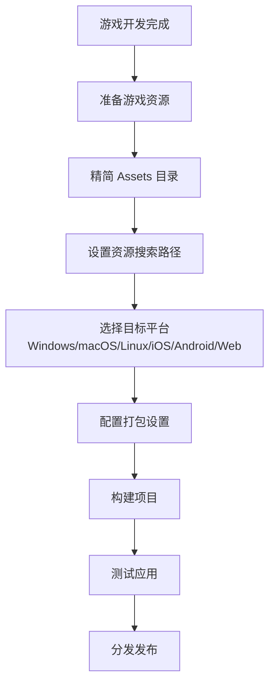

import DocScreenshot from '@site/src/components/DocScreenshot';
import exportImage from '@site/static/img/operations/export-dialog-zh.webp';
import exportFilesImage from '@site/static/img/operations/export-files.webp';
import exportBrowserImage from '@site/static/img/operations/export-browser.webp';

import Tabs from '@theme/Tabs';
import TabItem from '@theme/TabItem';

# 如何打包游戏为独立的应用

开发完成后，可以从 Web IDE 导出网页游戏，或从 Dora 的项目界面导出原生游戏包。下方的平台打包指南也介绍了从引擎源码构建的流程。

## 从 Web IDE 导出可玩的 Web 游戏

项目完成后，可以直接使用 Web IDE 导出。保持项目根目录包含 `init` 的正常结构，这个流程不需要构建引擎源码。

1. 保存项目，并先运行一次，确认脚本和资源能够加载。
2. 右键点击**项目文件夹**，选择**导出**；也可以打开项目文件，点击工具栏的导出按钮。
3. 本地直接打开的游戏选择**导出 HTML**；通过 HTTP 服务发布的游戏选择**导出 Server 版 HTML**。等待打包，再选择下载的保存位置。

<DocScreenshot src={exportImage} width={960} height={1040} alt="项目导出对话框：ZIP 及两种 Web 导出格式" maxWidth={600} />

### 解压并打开成品

**导出 HTML 下载的是 ZIP 压缩包**，例如 `Hello-web-html.zip`。完整解压后，在浏览器中打开根目录的 `index.html`。保留配套文件和 `html-assets` 目录；只复制 `index.html` 会缺少引擎和游戏资源。

<DocScreenshot src={exportFilesImage} width={1030} height={440} alt="解压后的 Web 游戏文件，选中 index.html，旁边保留 html-assets 和配套文件" maxWidth={600} />

下图是从 Hello 项目导出后，在 Edge 中直接打开解压目录的运行结果。

<DocScreenshot src={exportBrowserImage} width={3008} height={1724} alt="导出的 Hello 项目已从解压目录在浏览器中运行" />

选择**导出 Server 版 HTML**时，解压 ZIP，将整个输出目录上传到静态网站，再通过 HTTPS 或 localhost 打开其中的 `index.html`。该格式需要服务器，发布要求见压缩包内的 `README-Web.txt`。Godot Web 包还需要 COOP/COEP 响应头。

### 分享前验证

- 对照项目在 Dora 中的表现，检查导出后图片、字体、声音和输入是否正常。
- 服务器版本要测试部署后的网址和资源请求，不使用双击文件的方式验证。
- 备份或分享可编辑工程时选择**导出 ZIP 包**；HTML 选项则包含 Web 运行时。
- 项目修改后重新导出，并完整替换发布目录中的成品文件。

格式对照表见 [Web IDE 常用操作](./18.web-ide.mdx#导出项目)。下方流程概览和各平台章节介绍从引擎源码打包的方式。

## 从 Dora 直接导出原生游戏

- **Web IDE**。右键项目文件夹选择 **导出**，也可以打开项目文件后点击工具栏的 **导出**。引擎运行在 Windows 时选择 **导出 Windows ZIP**，运行在 Android 时选择 **导出 APK**。APK 的签名和保存都在运行 Dora 的安卓设备上完成。
- **Windows**。在 Dora 经典界面的项目列表中，对可运行的项目选择 **导出 Windows ZIP**，再选择保存目录。玩家完整解压 ZIP 后双击游戏 EXE，DLL 和资源需要与 EXE 一起保留。
- **Android**。安装完整的 Dora APK，在 Dora Go 的作品卡选择 **管理 → 分享作品 → 导出 APK**。确认包名和版本，为签名密钥设置密码，或导入已有的 PKCS#12 密钥。导出后可保存或分享 APK。
- TypeScript 或 TSX 作品需要先在 Dora 中编译。请从 Android 导出对话框备份签名密钥并保管密码。换设备时导入该密钥，使用原包名和更高的版本号，才能覆盖升级已安装的游戏。

要自定义 Android 桌面图标，把 `icon.png` 放在项目根目录，与 `init` 入口文件同级。推荐使用 512 × 512 像素的方形 PNG。Dora 会保留透明区域，非方形图片会等比缩放并居中。没有该文件时，导出的 APK 使用 Android 系统的通用应用图标。

## 打包流程概览



## 1. 准备游戏资源

以下 `Assets` 指引擎原生应用的发行资源目录。Web IDE 项目可以直接保留 `init`、Image、Audio 等项目目录；使用上方的导出流程时，无需把它们改成这里的结构。

### 1.1 标准项目结构

```
Assets/
├── Script/
│   ├── init.lua          # 游戏入口脚本
│   ├── main.lua          # 主游戏逻辑
│   └── Lib/              # 引擎库文件（必须保留）
├── Image/
│   ├── player.png        # 角色图片
│   └── background.png    # 背景图片
├── Audio/
│   ├── bgm.mp3          # 背景音乐
│   └── sfx.wav          # 音效
└── Font/
    └── game-font.ttf    # 游戏字体
```

### 1.2 必需资源类型

- **美术资源**：如图像、动画、UI 素材等
- **音频文件**：包括背景音乐和音效
- **字体文件**：游戏中使用的所有字体
- **程序脚本**：包括 Lua（原生或是编译自其他语言的代码文件）或 WASM 二进制程序文件

> **重要提示**：这些资源是游戏运行的必要组成部分，必须被包含在最终的应用包中。

## 2. 精简 Assets 目录

&emsp;&emsp;为了减小最终应用包的大小，需要清理不必要的开发文件。

### 2.1 必须保留的文件

```
Assets/
├── Script/Lib/              # 游戏引擎运行时库
│   ├── UI/                  # UI 组件库
│   └── [其他引擎库文件]       # 必须保留
└── gamecontrollerdb.txt     # 游戏手柄配置文件
```

### 2.2 按启动依赖裁剪文件

```
Assets/
├── Script/Dev/              # 替换默认开发启动入口后，才可裁剪
├── Script/Tools/            # 不被游戏入口使用的开发工具
├── Script/Lib/Dora/         # 引擎 API 定义文件（可删除）
├── Doc/                     # 文档（可删除）
├── www/                     # 不再使用 Web IDE 时的候选裁剪内容
└── [其他开发相关文件]          # 可删除
```

> **优化建议**：删除不必要的文件可以显著减小应用包大小，通常可以减少发布应用的体积。

默认 `Assets/Script/init.yue` 对应的启动脚本会加载 `Script.Dev.Bootstrap` 和 `Script.Dev.Entry`。保留默认启动方式时，需要保留这些依赖。制作游戏专用资源包时，先准备独立的游戏启动入口并验证启动，再裁剪未使用的开发工具；不要直接删除工作中的引擎源码目录。

## 3. 设置资源搜索路径

&emsp;&emsp;确保独立打包的游戏与 Web IDE 环境下的资源加载行为保持一致。

### 3.1 默认搜索路径

Dora SSR Web IDE 默认的资源搜索路径：

1. **游戏项目根目录/Script**
2. **引擎内置资源根目录/Script/Lib**
3. **游戏项目根目录**

### 3.2 配置示例

在游戏入口脚本（通常是 `init.lua`）的开头添加以下代码：

```lua title="Assets/Script/init.lua"
local Path <const> = require("Path")
local Content <const> = require("Content")

-- 设置资源搜索路径
Content.searchPaths = {
	Path(Content.assetPath, "Script"),        -- 游戏脚本目录
	Path(Content.assetPath, "Script", "Lib"), -- 引擎库目录
	Content.assetPath,                  -- 游戏根目录
}

-- 游戏主逻辑
local function main()
    -- 你的游戏代码从这里开始
    print("游戏启动成功！")
end

main()
```

## 4. 平台打包指南

### 4.1 平台对比表

<div style={{maxWidth: '100%', overflowX: 'auto'}}>

| 平台 | 开发工具 | 输出格式 | 签名要求 | 发布渠道 |
|------|----------|----------|----------|----------|
| Windows | xmake + Visual Studio C++ 工具 | 包含 .exe 的 ZIP / MSI 安装包 | 可选 | Steam、官网、其他平台 |
| macOS | xmake + Xcode | 包含 .app 的 ZIP | 分发时必需 | App Store、官网 |
| Linux | xmake + 系统开发包 | AppImage | 可选 | Steam、官网 |
| iOS | xmake + Xcode | 模拟器 ZIP / 真机 .ipa | 真机分发时必需 | App Store |
| Android | xmake + Android Studio SDK/Gradle/CMake | .apk/.aab | 分发时必需 | Google Play、其他商店 |
| Web | xmake 管理的 Emscripten + Node.js | 静态网站目录 | 无 | itch.io（HTML）、GitHub Pages、任意静态托管 |

</div>

下列原生平台任务构建并打包 Dora 的平台应用。游戏专用启动资源、应用标识和发行签名需要一并配置；任务不会自动把当前工作空间项目变成游戏专用安装包。

### 4.2 各平台的打包操作

安装[构建前置依赖](./120.dev-configuration.mdx)后，在 Dora-SSR 仓库根目录执行以下命令。应用元数据和资源维护在 `Projects/` 下，其中打包资源位于 `Projects/packaging/`；不要修改生成的 IDE 工程来配置打包。Release 模式本身不会提供正式发布的签名凭据。

<Tabs groupId="platform-select">
<TabItem value="windows" label="Windows">

```sh
xmake app-package --platform=windows --arch=x64 --mode=release --windows-backend=d3d12 --format=both
```

Windows 发布包仅支持 **x64**。`--windows-backend=d3d12` 为默认值；改用 `--windows-backend=wgl` 可生成文件名带 `-opengl` 的 OpenGL 版。`--format` 可选 `zip`（默认）、`msi` 或 `both`。打包 MSI 需要 WiX CLI 和 UI 扩展；发布工作流使用 WiX 5.0.2 和 `WixToolset.UI.wixext/5.0.2`。

产物位于 `build/package/windows/x64/release/d3d12/` 或 `build/package/windows/x64/release/wgl/`。MSI 为当前用户安装，创建开始菜单快捷方式并注册 `dora-ssr://` 链接；ZIP 为便携版，可按需运行 `RegisterDoraLinks.cmd` 注册链接。两种后端共用同一 MSI 产品系列：安装另一后端会替换已有安装，不会并排安装第二份。

</TabItem>
<TabItem value="macos" label="macOS">

```sh
xmake app-package --platform=macosx --mode=release
```

产物位于 `build/package/` 的对应平台目录；Android 位于 `Projects/Android/Dora/app/build/outputs/`。应用名称、版本、图标与平台资源在 `Projects/` 中修改，构建参数在 `Projects/xmake/` 中修改，不修改生成的 IDE 工程。

</TabItem>
<TabItem value="linux" label="Linux">

```sh
xmake app-package --platform=linux --mode=release
```

产物位于 `build/package/` 的对应平台目录；Android 位于 `Projects/Android/Dora/app/build/outputs/`。应用名称、版本、图标与平台资源在 `Projects/` 中修改，构建参数在 `Projects/xmake/` 中修改，不修改生成的 IDE 工程。

</TabItem>
<TabItem value="ios" label="iOS">

```sh
xmake app-package --platform=ios --mode=release --appledev=device
```

产物位于 `build/package/` 的对应平台目录；Android 位于 `Projects/Android/Dora/app/build/outputs/`。应用名称、版本、图标与平台资源在 `Projects/` 中修改，构建参数在 `Projects/xmake/` 中修改，不修改生成的 IDE 工程。

默认 iOS device IPA 为 ad-hoc，不可直接安装/分发。设置已安装的 `DORA_IOS_SIGN_IDENTITY` 和 `DORA_IOS_PROVISION` 后另行验收正式签名。

</TabItem>
<TabItem value="android" label="Android">

```sh
xmake app-package --platform=android --mode=release
```

产物位于 `build/package/` 的对应平台目录；Android 位于 `Projects/Android/Dora/app/build/outputs/`。应用名称、版本、图标与平台资源在 `Projects/` 中修改，构建参数在 `Projects/xmake/` 中修改，不修改生成的 IDE 工程。

```sh
xmake app-package --platform=android --mode=release --format=aab
```

</TabItem>
<TabItem value="web" label="Web">

&emsp;&emsp;Web 导出会将游戏与引擎的 WebAssembly 构建打包在一起，产物是一个纯静态文件目录：托管到任意静态服务器后，玩家在桌面或移动浏览器中打开即可直接游玩，玩家设置与游戏存档会保存在浏览器存储中。

#### 步骤 1：构建 Web Player

在引擎仓库根目录构建一次 Web Player，xmake 任务会按需安装受管 Emscripten 工具链：

```bash
xmake web
```

任务会在 `result/dora-web-player` 下生成一个自包含的 Player 包，包含 `index.html`、Player 运行时以及一个内置示例游戏。默认的 `dora-preset` 配置覆盖常见 2D 游戏；可使用 `--profile=core` 或 `--profile=custom`（也可设置 `DORA_WEB_PROFILE`）选择其他配置，并在构建前启用诸如 `DORA_WEB_FEATURE_MODEL_3D=ON` 的可选功能。pthread 版本使用 `xmake web --pthreads`，通过带 COOP/COEP 响应头的服务访问 `result/dora-web-player-pthreads`。

#### 步骤 2：打包游戏

```bash
xmake web-game -- <游戏目录> <输出目录> [入口文件]
```

`<游戏目录>` 是精简后、包含入口文件（默认为 `init.lua`）的游戏目录。脚本会向 `<输出目录>` 写入 `dora-web-manifest.json` 以及带内容哈希的 `assets/` 文件；每个文件在浏览器加载时都会做 SHA-256 校验。单个游戏包最多包含 4096 个文件、总计 256 MB。

#### 步骤 3：合并并部署

将 Player 与游戏包复制进同一个目录——替换掉内置示例游戏——然后上传到任意静态文件服务器：

```bash
mkdir -p dist/web-game
# Player 文件；跳过属于示例游戏的 dora-web-manifest.json 和 assets/
cp result/dora-web-player/index.html result/dora-web-player/dora-player-runtime.* \
	result/dora-web-player/dora-web-features.json result/dora-web-player/dora-audio-mixer.wasm \
	result/dora-web-player/audio-worklet.js dist/web-game/
cp <输出目录>/dora-web-manifest.json dist/web-game/
cp -r <输出目录>/assets dist/web-game/
```

页面默认加载 `index.html` 旁的 `dora-web-manifest.json` 并自动启动游戏。支持当前稳定版本的 Chrome、Edge、Firefox 与 Safari 浏览器。

</TabItem>
</Tabs>

## 5. 实践示例：简单游戏打包

### 5.1 示例游戏项目

让我们以一个简单的"点击方块"游戏为例，展示完整的打包流程。

#### 游戏代码示例

```lua title="Assets/Script/init.lua"
local Path <const> = require("Path")
local Content <const> = require("Content")
local Node <const> = require("Node")
local Sprite <const> = require("Sprite")
local Label <const> = require("Label")
local Vec2 <const> = require("Vec2")
local Director <const> = require("Director")

-- 设置资源搜索路径
Content.searchPaths = {
	Path(Content.assetPath, "Script"),
	Path(Content.assetPath, "Script", "Lib"),
	Content.assetPath,
}

-- 游戏主场景
local function createGameScene()
	local scene = Node()

	-- 创建背景
	local bg = Sprite("Image/background.png")
	bg:addTo(scene)

	-- 创建可点击的方块
	local block = Sprite("Image/block.png")
	block:addTo(scene)
	block.position = Vec2(0, -50)
	block.touchEnabled = true

	-- 创建分数显示
	local scoreLabel = Label("game-font", 32)
	scoreLabel:addTo(scene)
	scoreLabel.position = Vec2(0, 100)
	scoreLabel.text = "Score: 0"

	local score = 0

	-- 点击事件
	block:onTapBegan(function()
		score = score + 1
		scoreLabel:setString("分数: " .. score)
		block.scaleX = 0.9
		block.scaleY = 0.9
	end)

	block:onTapEnded(function()
		block.scaleX = 1.0
		block.scaleY = 1.0
	end)

	return scene
end

-- 启动游戏
local gameScene = createGameScene()
gameScene:addTo(Director.entry)
```

### 5.2 打包步骤

1. **准备资源文件**
   - 将 `background.png` 和 `block.png` 放入 `Assets/Image/`
   - 将字体文件放入 `Assets/Font/`

2. **精简目录**
   - 在独立的发行资源副本中配置游戏启动入口
   - 启动验证通过后，仅移除入口不再依赖的工具和文档

3. **选择平台打包**
   - 按照上述平台指南进行配置和构建

## 6. 测试和发布

### 6.1 测试清单

- [ ] 游戏正常启动
- [ ] 所有资源正确加载
- [ ] 音效和音乐播放正常
- [ ] 在不同设备上测试
- [ ] 性能表现良好

### 6.2 常见问题解决

#### 问题 1：资源加载失败
**解决方案**：检查资源搜索路径配置和文件路径是否正确

#### 问题 2：应用包过大
**解决方案**：删除不必要的开发文件，压缩图片资源

#### 问题 3：签名错误
**解决方案**：确保使用正确的开发者证书和 Bundle Identifier

### 6.3 发布渠道

- **Steam**：适合 PC 游戏
- **App Store**：iOS 和 macOS 应用
- **Google Play**：Android 应用
- **官网下载**：直接分发
- **itch.io**：独立游戏平台
- **静态网站托管**：通过 Web Player 导出的浏览器游戏（GitHub Pages、itch.io HTML 或自有服务器）

## 总结

Web 游戏可以从 Web IDE 直接导出：完整解压 HTML 版的 ZIP 后打开 `index.html`，或把 Server 版的整个目录部署到服务器。分享可编辑工程使用普通 ZIP 导出。

原生应用需要配置游戏启动资源、平台构建与签名。精简资源之前先验证启动依赖，完成打包后再检查图片、字体、声音和输入。

## 相关文档

- **[开发配置教程](/docs/tutorial/dev-configuration)** - 开发环境配置指南
